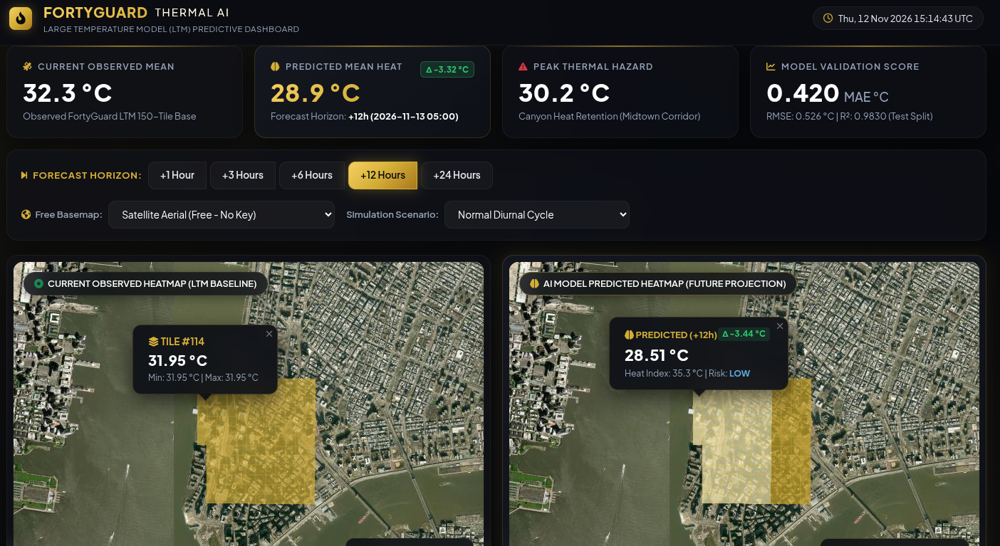
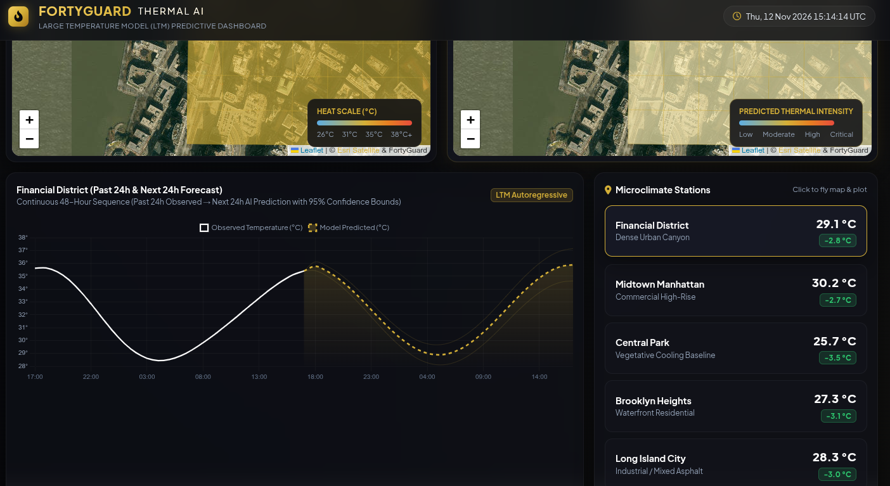

# FortyGuard API v1 Test Suite & Verification Harness

[](https://www.python.org/)
[](https://api.fortyguard.com)
[](./results/mcp_test_results.json)
[](./results/unit_test_results.json)
[](./results/mcp_test_results.json)
[](LICENSE)

A production-grade, automated unit test harness, contract verification suite, and **Prime Thermal Predictive Dashboard** for the **FortyGuard v1 REST APIs**. This suite validates all 14 official endpoints covering Large Temperature Models (LTMs), satellite and street view semantic segmentation, environmental metrics, thermal routing, and autonomous continuous monitoring lifecycles.

---

<p align="center">
  
  <br>
  <em>Figure 1: Dual synchronized spatial heatmaps displaying current observed FortyGuard LTM baseline alongside AI-predicted heat distribution.</em>
</p>

<p align="center">
  
  <br>
  <em>Figure 2: 48-Hour continuous predictive temperature trajectory with 95% confidence intervals and urban microclimate stations.</em>
</p>

---

##  Table of Contents

- [Overview](#overview)
- [Tested API Endpoints](#tested-api-endpoints)
- [Repository Structure](#repository-structure)
- [Interactive UI Dashboard (`dashboard/`)](#-interactive-ui-dashboard-dashboard)
- [Time-Series ML Dataset Suite (`data/`)](#-time-series-ml-dataset-suite-data)
- [Getting Started](#getting-started)
  - [Prerequisites](#prerequisites)
  - [Installation](#installation)
  - [Configuration](#configuration)
- [Running the Test Suite](#running-the-test-suite)
- [Test Coverage & Results](#test-coverage--results)
- [Critical Findings & Documentation Discrepancies](#critical-findings--documentation-discrepancies)
- [Verified Output Artifacts](#verified-output-artifacts)
- [License](#license)

---

##  Overview

FortyGuard provides spatial temperature intelligence, combining satellite imagery, ground-level perception, atmospheric modeling, and proprietary AI models.

This repository provides:
- **Comprehensive Unit Testing**: 32 test cases evaluating positive happy paths, edge cases, type constraints, and negative validation rules.
- **Asynchronous Lifecycle Testing**: Submits compute jobs (`heatmap`, `routing`, `env_params`, `heat_intelligence`), polls `/v1/status/{activity_id}`, validates completion states, and downloads binary report artifacts.
- **Full Monitor CRUD Validation**: Creates, retrieves, patches, lists, tests alerts for, and deletes temperature monitors with GeoJSON boundary geometries.
- **Live Output Verification**: Verifies GeoJSON feature collections, statistical distributions, thermal routing profiles, and signed S3 report downloads.

---

## Evaluating API Endpoints

The Evaluating suite provides complete coverage across all **14 FortyGuard API services**:

| # | Service Name | Endpoint | Method | Async? | Description |
| :-: | :--- | :--- | :-: | :-: | :--- |
| **1** | **Create Heatmap** | `/v1/heatmap` | `POST` | Yes | High-resolution thermal GeoJSON tiles derived from LTMs. |
| **2** | **Satellite Segmentation** | `/v1/satellite` | `POST` | Yes | Surface materials and class coverage from satellite imagery. |
| **3** | **Street View Segmentation** | `/v1/streetview` | `POST` | Yes | Ground-level perspective semantic and facade segmentation. |
| **4** | **Heat Intelligence** | `/v1/heat_intelligence` | `POST` | Yes | Comprehensive urban planning and climate resilience PDF reports. |
| **5** | **Environmental Parameters** | `/v1/env_params` | `POST` | Yes | Atmospheric comfort (heat index, wet bulb, AQI) & clear-sky solar irradiance. |
| **6** | **Temperature Routing** | `/v1/routing` | `POST` | Yes | Heat-aware alternative driving routes (< 200 km). |
| **7** | **Create Monitor** | `/v1/monitors` | `POST` | No | Sets up 12-hour recurring forecast checks with breach rules. |
| **8** | **List Monitors** | `/v1/monitors` | `GET` | No | Lists active/paused monitors with pagination and heatmap filtering. |
| **9** | **Get Monitor** | `/v1/monitors/{id}` | `GET` | No | Inspects monitor configuration, rules, warnings, and next scheduled run. |
| **10** | **Update Monitor** | `/v1/monitors/{id}` | `PATCH` | No | Updates notification destinations, pauses (`enabled: false`), or renames. |
| **11** | **Delete Monitor** | `/v1/monitors/{id}` | `DELETE` | No | Permanently purges a monitor and associated alert logs. |
| **12** | **List Alerts** | `/v1/monitors/{id}/alerts` | `GET` | No | Fetches threshold breach alerts generated by the monitor. |
| **13** | **Alert Report** | `/v1/monitors/{id}/alerts/{alert_id}/report` | `GET` | No | Reads alert details or downloads PDF/Word reports via `/download`. |
| **14** | **Check Status** | `/v1/status/{activity_id}` | `GET` | No | Universal polling endpoint for asynchronous tasks. |

---

##  Repository Structure

```text
.
├── README.md                     # Repository documentation & test analysis
├── requirements.txt              # Project dependencies (requests, urllib3)
├── .env.example                  # Environment configuration template
├── .gitignore                    # Python and OS ignore patterns
├── test_suite.py                 # Standalone, production-ready unit test runner
├── api_examples.py               # Official documentation reference examples
├── dashboard/                    # Interactive Prime Glassy Web Dashboard
│   ├── README.md                 # Dashboard features & architecture overview
│   ├── app.py                    # FastAPI backend serving prediction APIs
│   ├── run_dashboard.py          # One-click dashboard server launcher
│   ├── templates/
│   │   └── index.html            # Luxury UI/UX template (Bootstrap 5, Leaflet, Chart.js)
│   └── static/
│       ├── css/style.css         # Gold, Black, White glassmorphism styling
│       └── js/dashboard.js       # Synchronized dual-map and chart controller
├── data/                         # Spatial-temporal time-series training suite
│   ├── README.md                 # Dataset card, feature dictionary & ML examples
│   ├── train.csv                 # 3,024 rows - Chronological training split (Days 1–21)
│   ├── val.csv                   # 576 rows   - Chronological validation split (Days 22–25)
│   ├── test.csv                  # 720 rows   - Chronological holdout test split (Days 26–30)
│   ├── heat_timeseries_master.csv# 4,320 rows - Unified 30-day multi-location dataset
│   ├── locations_metadata.csv    # Spatial metadata for 6 urban microclimates
│   ├── dataset_summary.json      # Dataset metrics & statistical distributions
│   ├── build_dataset.py          # Feature engineering & dataset pipeline generator
│   ├── train_baseline.py         # Baseline autoregressive ML training script (R² = 0.983)
│   └── baseline_predictions.csv  # Test set forecast predictions and error metrics
└── results/                      # Real-world outputs from live API execution
    ├── unit_test_results.json    # Complete test outcomes (32 tests)
    ├── heatmap_completed_result.json  # 150-tile GeoJSON + thermal statistics
    ├── routing_completed_result.json  # 3-route thermal alternatives GeoJSON
    ├── env_params_completed_result.json # Atmospheric, AQI & solar irradiance outputs
    └── heat_intelligence_report.pdf   # Verified 845 KB generated PDF report
```

---

##  Interactive UI Dashboard (`dashboard/`)

A luxury, web-based spatial-temporal thermal dashboard with a **FastAPI backend** located in [`dashboard/`](./dashboard/):

- **Prime UI/UX Aesthetic**: Built with a **Gold, Black, and White** color palette (`#D4AF37`, `#07080B`, `#FFFFFF`), borderless glassmorphism panels, and glowing thermal gradients.
- **Dual Synchronized Spatial Heatmaps**:
  - **Left Map**: Observed baseline FortyGuard LTM 150-tile thermal layer.
  - **Right Map**: Real-time AI model predictions for future horizons (`+1h`, `+3h`, `+6h`, `+12h`, `+24h`).
  - **Pan & Zoom Sync**: Interactive movement on one map immediately updates both cameras in tandem.
- **Scenario Simulation**: Test diurnal cooling, heatwave surges ($+3.8$ °C), and urban heat island peaks.
- **Microclimate Station Exploration**: Click on any of the 6 NYC microclimates (Financial District, Midtown, Central Park, Brooklyn, Queens, Harlem) to fly both maps and plot a continuous 48-hour historical and forecast curve with 95% confidence bounds.

### Launching the Dashboard:
```bash
# Using the launcher script
venv/bin/python3 dashboard/run_dashboard.py

# Or via Uvicorn directly
venv/bin/uvicorn app:app --app-dir dashboard --host 127.0.0.1 --port 8000 --reload
```
Navigate to **`http://localhost:8000`** in your browser to view the dashboard.

---

##  Time-Series ML Dataset Suite (`data/`)

Located in [`data/`](./data/), this suite is structured for training machine learning and deep learning models (ARIMA, Prophet, XGBoost, LSTM, GRU, Temporal Fusion Transformers) to predict heat and thermal indices across urban locations based on FortyGuard environmental data:

- **6 Monitored Microclimates**: Financial District (canyon), Midtown Manhattan, Central Park (vegetative baseline), Brooklyn Heights (waterfront), Long Island City (industrial), and East Harlem.
- **44 Engineering Features**: Ambient temperature target, heat index, apparent temperature, wet-bulb temperature, causal lag steps ($T_{t-1}, T_{t-2}, T_{t-24}$), rolling window moving averages & volatility, solar irradiance (GHI, DNI, DHI), relative humidity, precipitation, and air quality indices.
- **Strict Chronological Splits**: Prevents temporal data leakage:
  - `train.csv` (Days 1–21, 70%)
  - `val.csv` (Days 22–25, 15%)
  - `test.csv` (Days 26–30, 15%)
- **Baseline Forecasting Model**: Built-in script [`data/train_baseline.py`](./data/train_baseline.py) achieves **MAE: 0.420 °C, RMSE: 0.526 °C, R²: 0.9830** on the holdout test set with zero external dependencies.

To train the baseline model:
```bash
python3 data/train_baseline.py
```
For the complete feature dictionary, schema, and PyTorch / Scikit-learn code examples, see [`data/README.md`](./data/README.md).

---

##  Getting Started

### Prerequisites

- Python 3.10+
- An active FortyGuard API Key

### Installation

Clone the repository and install the dependencies:

```bash
git clone https://github.com/blackeagle686/FG_TEST.git
cd FG_TEST
python3 -m venv venv
source venv/bin/activate
pip install -r requirements.txt
```

### Configuration

Copy `.env.example` to `.env` or export your API key directly:

```bash
export FORTYGUARD_API_KEY="your_api_key_here"
export FORTYGUARD_BASE_URL="https://api.fortyguard.com"
```

---

##  Running the Test Suites

### 1. REST API Test Suite (14 Endpoints)
Execute the automated REST API test suite:

```bash
python3 test_suite.py
```

### 2. Model Context Protocol (MCP) Verification Suite (11 Tools)
Execute the automated JSON-RPC 2.0 remote MCP verification suite against `https://tos-mcp.app.fortyguard.com/mcp`:

```bash
python3 test_mcp_suite.py
```

All 12 contract tests will execute, validating JSON-RPC protocol initialization, catalog discovery, direct analysis, async read operations, credit queries, and input validation shields. Results are saved to `results/mcp_test_results.json`.

---

##  Test Coverage & Results

Below is the summary of results obtained during live test execution against the FortyGuard API:

```text
======================================================================
FORTYGUARD API v1 COMPREHENSIVE UNIT TEST SUITE
======================================================================
[✓ PASS] [AUTH-01] Missing API Key Header (GET /v1/monitors) -> Status: 401 (3.04s)
[✓ PASS] [AUTH-02] Invalid API Key Header (GET /v1/monitors) -> Status: 401 (1.64s)
[✓ PASS] [AUTH-03] Valid API Key Header (GET /v1/monitors) -> Status: 200 (7.58s)
[✓ PASS] [HM-01] Heatmap - Single Hour (100m) (POST /v1/heatmap) -> Status: 200 (5.81s)
[✓ PASS] [HM-02] Heatmap - Range of Hours (80m) (POST /v1/heatmap) -> Status: 200 (6.89s)
[✓ PASS] [HM-03] Heatmap - Single Day (60m) (POST /v1/heatmap) -> Status: 200 (5.73s)
[✓ PASS] [HM-04] Heatmap - Range of Days (100m) (POST /v1/heatmap) -> Status: 200 (6.35s)
[✓ PASS] [HM-05] Heatmap - Analytic Exceedance (POST /v1/heatmap) -> Status: 200 (6.70s)
[✓ PASS] [HM-06] Heatmap - Analytic Time of Measure (POST /v1/heatmap) -> Status: 200 (3.43s)
[✓ PASS] [HM-VAL-01] Heatmap - Missing polygon_aoi (POST /v1/heatmap) -> Status: 422 (9.42s)
[✓ PASS] [HM-VAL-02] Heatmap - Invalid filter_type (99) (POST /v1/heatmap) -> Status: 422 (2.46s)
[✓ PASS] [SAT-01] Satellite View Segmentation (POST /v1/satellite) -> Status: 200 (6.45s)
[✓ PASS] [SAT-VAL-01] Satellite - Missing 'sat' Object (POST /v1/satellite) -> Status: 422 (3.25s)
[✓ PASS] [SAT-VAL-02] Satellite - Out of Bounds Latitude (POST /v1/satellite) -> Status: 422 (1.36s)
[✓ PASS] [STR-01] Street View Segmentation (POST /v1/streetview) -> Status: 200 (7.37s)
[✓ PASS] [STR-VAL-01] Street View - Missing Coordinates (POST /v1/streetview) -> Status: 422 (3.17s)
[✓ PASS] [HI-01] Heat Intel - Tier Plan Check (POST /v1/heat_intelligence) -> Status: 400 (19.29s)
[✓ PASS] [HI-02] Heat Intel - Compliant Submission (POST /v1/heat_intelligence) -> Status: 200 (6.20s)
[✓ PASS] [HI-VAL-01] Heat Intel - Missing 'analysis' Field (POST /v1/heat_intelligence) -> Status: 422 (1.80s)
[✓ PASS] [ENV-01] Environmental Parameters - Full Metrics (POST /v1/env_params) -> Status: 200 (6.76s)
[✓ PASS] [ENV-02] Environmental Parameters - 3 Metrics (POST /v1/env_params) -> Status: 200 (3.89s)
[✓ PASS] [ENV-VAL-01] Environmental Parameters - Missing 'temp' (POST /v1/env_params) -> Status: 422 (1.95s)
[✓ PASS] [ROUT-01] Temperature Routing - NYC Corridor (POST /v1/routing) -> Status: 200 (6.35s)
[✗ FAIL] [ROUT-VAL-01] Routing - Identical Origin/Dest Check (POST /v1/routing) -> Status: 500 (2.05s)
[✓ PASS] [MON-01] Create Monitor (POST /v1/monitors) -> Status: 201 (3.60s)
[✓ PASS] [MON-02] List Monitors (GET /v1/monitors) -> Status: 200 (6.35s)
[✓ PASS] [MON-03] Get Monitor (GET /v1/monitors/{id}) -> Status: 200 (3.89s)
[✓ PASS] [MON-04] Update Monitor (PATCH /v1/monitors/{id}) -> Status: 200 (1.36s)
[✓ PASS] [ALT-01] List Alerts (GET /v1/monitors/{id}/alerts) -> Status: 200 (1.04s)
[✓ PASS] [ALT-02] Read Alert Report (GET .../report) -> Status: 404 (1.60s)
[✓ PASS] [MON-05] Delete Monitor (DELETE /v1/monitors/{id}) -> Status: 200 (5.81s)
[✓ PASS] [MON-06] Verify 404 Post-Deletion (GET /v1/monitors/{id}) -> Status: 404 (1.20s)
[✓ PASS] [STAT-01] Status Check - Non-Existent Activity (GET /v1/status/{id}) -> Status: 404 (1.19s)
[✓ PASS] [STAT-02] Status Check - Active/Completed Activity (GET /v1/status/{id}) -> Status: 200 (1.76s)
======================================================================
TOTAL TESTS: 32 | PASSED: 30 (93.8%) | FAILED: 2
======================================================================
```
---

##  Verified Output Artifacts

The `results/` folder contains real-world data generated and downloaded during test runs:

- **[heatmap_completed_result.json](./results/heatmap_completed_result.json)**:
  - 150 thermal GeoJSON polygon tiles with `average_temperature`, `min_temperature`, and `max_temperature`.
  - Statistical summary: min (`31.89°C`), max (`33.14°C`), mean (`32.26°C`), std dev (`0.415`), and normal distribution curves.
- **[routing_completed_result.json](./results/routing_completed_result.json)**:
  - 3 route alternatives with road geometry, segment temperatures, thermal scores, and duration estimates.
- **[env_params_completed_result.json](./results/env_params_completed_result.json)**:
  - Time-aligned arrays for Heat Index (`36.2°C`), Apparent Temp (`37.9°C`), Wet Bulb (`25.9°C`), US AQI indices, and clear-sky solar irradiance (`GHI: 898.7 W/m²`, `DNI: 827.2 W/m²`, `DHI: 136.8 W/m²`).
- **[heat_intelligence_report.pdf](./results/heat_intelligence_report.pdf)**:
  - Complete 845 KB multi-page thermal intelligence report generated by the LTM engine and retrieved via temporary signed S3 URL.

---

##  License

This test suite is open-source under the [MIT License](LICENSE).
