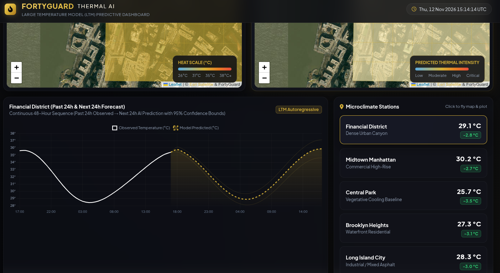
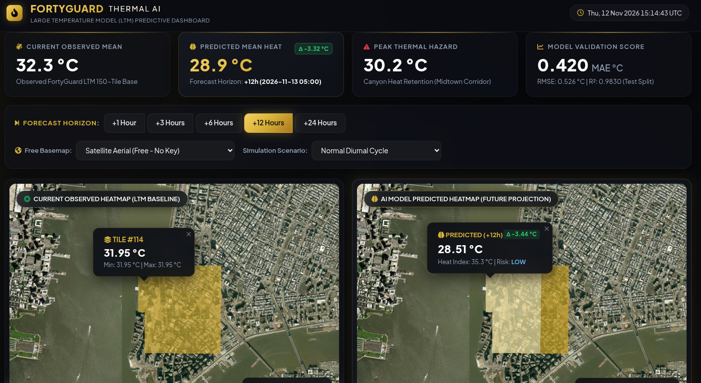

# FortyGuard Urban Thermal AI - Prime Predictive Dashboard

[](https://fastapi.tiangolo.com)
[](https://getbootstrap.com)
[](https://leafletjs.com)
[](https://www.chartjs.org)
[](#design-system)

An interactive, spatial-temporal web dashboard with a **FastAPI backend** designed to visualize real-time observed urban heatmaps alongside AI-predicted thermal distributions over customizable forecast horizons.

---

<p align="center">
  
  <br>
  <em>Figure 1: Dual synchronized spatial heatmaps displaying current observed FortyGuard LTM baseline alongside AI-predicted heat distribution.</em>
</p>

<p align="center">
  
  <br>
  <em>Figure 2: 48-Hour continuous predictive temperature trajectory with 95% confidence intervals and urban microclimate stations.</em>
</p>

---

##  Design System: Prime Gold, Black & White Glassmorphism

Built strictly according to luxury aesthetic principles:
- **Palette**: Deep Obsidian `#07080B`, Metallic Gold `#D4AF37`, Champagne Light `#F3E5AB`, and Crisp White `#FFFFFF`.
- **Glassmorphic Panels**: Borderless, sleek cards featuring `backdrop-filter: blur(20px)`, subtle translucent glowing borders (`rgba(212, 175, 55, 0.18)`), and soft layered drop shadows.
- **Micro-Interactions**: Hover transitions, pulsing real-time engine beacons, smooth fly-to camera controls, and synchronized panning.

---

##  Key Features

1. **Dual Synchronized Spatial Heatmaps**:
   - **Left Map**: Current observed FortyGuard LTM 150-tile thermal layer.
   - **Right Map**: Model-predicted thermal distribution for the selected time horizon (+1h, +3h, +6h, +12h, +24h).
   - **Camera Synchronization**: Moving or zooming either map instantly pans both views in tandem.
   - **Interactive Hover Tooltips**: Inspects Tile ID, current temperature, predicted heat, temperature delta ($\Delta$ °C), and heat risk classification.

2. **Temporal & Scenario Controls**:
   - Radio pill selectors for fast horizon switching: `+1h`, `+3h`, `+6h`, `+12h`, `+24h`.
   - Scenario simulation dropdown: *Normal Diurnal Cycle*, *Heatwave Surge (+3.8 °C)*, *Marine Breeze Front (-2.5 °C)*, and *Peak Urban Heat Island (+2.0 °C)*.

3. **Dynamic KPI Metrics**:
   - Live displays for Observed Mean Heat, Predicted Mean Heat, Temperature Change ($\Delta$ °C), Peak Thermal Hazard Hotspot, and Model Validation Benchmark ($R^2 = 0.9830$).

4. **Continuous 48-Hour Forecast Trajectory (Chart.js)**:
   - Visualizes past 24 hours observed temperatures transitioning seamlessly into next 24 hours model predictions with 95% confidence intervals.

5. **NYC Microclimate Monitoring Stations**:
   - Interactive cards for 6 urban microclimates (Financial District, Midtown Manhattan, Central Park, Brooklyn Heights, Long Island City, East Harlem).
   - Clicking any station automatically flies both maps to its coordinates and plots its specific forecast curve.

---

##  Running the Dashboard

### 1. Launching via Python Script
```bash
venv/bin/python3 dashboard/run_dashboard.py
```

### 2. Launching via Uvicorn Directly
```bash
venv/bin/uvicorn app:app --app-dir dashboard --host 127.0.0.1 --port 8000 --reload
```

Open your browser to:
=> **`http://localhost:8000`**

---

##  Backend API Endpoints

| Endpoint | Method | Description |
| :--- | :---: | :--- |
| `/` | `GET` | Serves the HTML5 Prime Glassy Dashboard. |
| `/api/health` | `GET` | Reports engine status, active model architecture, and tile count. |
| `/api/heatmap/current` | `GET` | Returns the GeoJSON FeatureCollection of the observed 150-tile baseline. |
| `/api/heatmap/predict` | `GET` | Generates future spatial heat distribution given `hours_ahead` and `scenario`. |
| `/api/locations` | `GET` | Returns the 6 microclimate stations with current and predicted heat values. |
| `/api/timeseries/{id}` | `GET` | Returns 48-hour continuous sequential data (historical + forecast + bounds). |
| `/api/metrics` | `GET` | Returns model evaluation benchmarks ($R^2$, MAE, RMSE, MAPE). |
